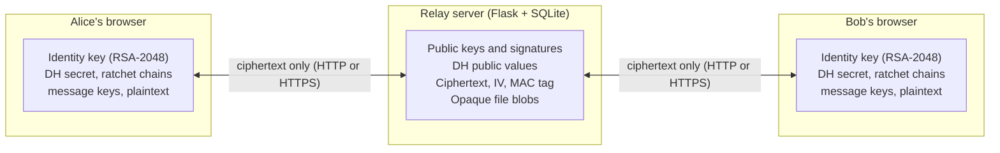
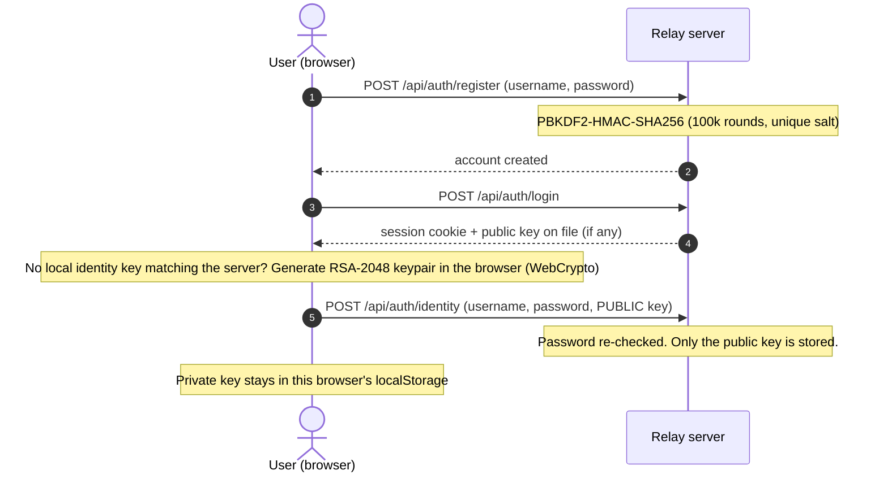
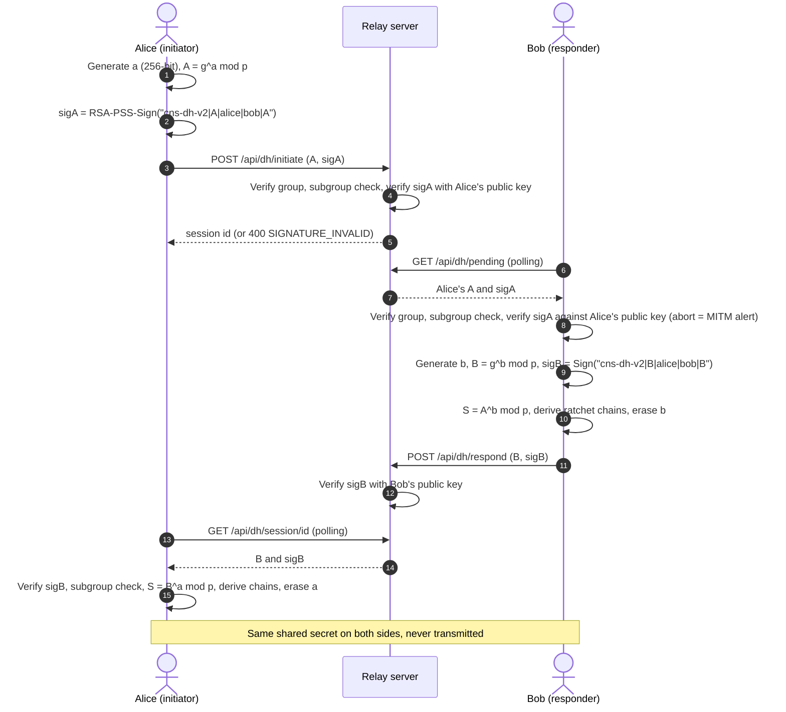
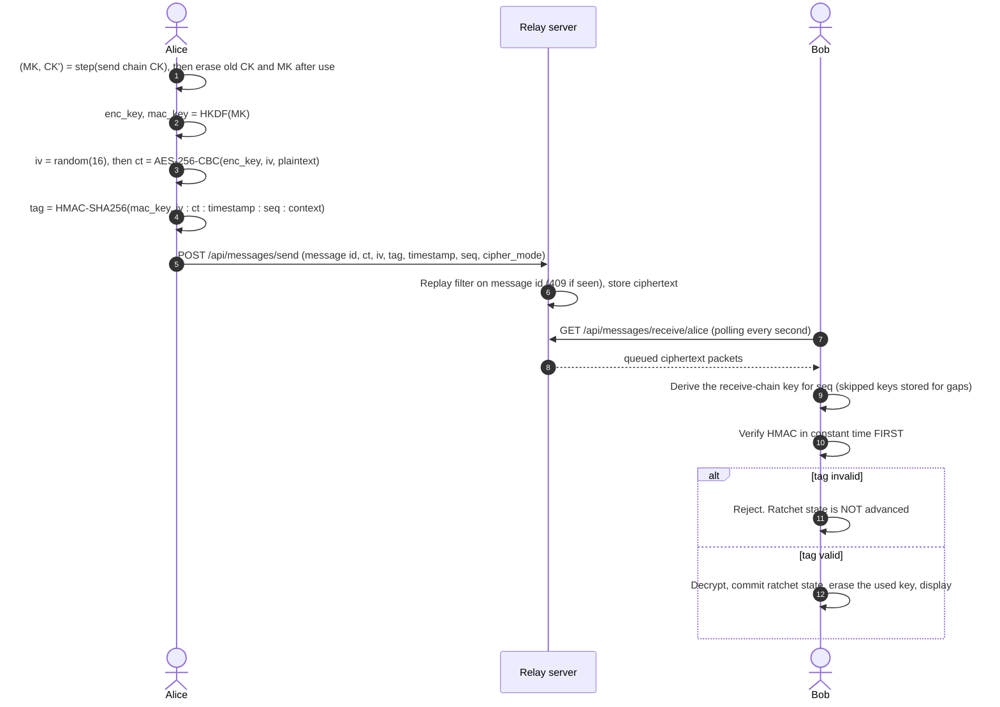
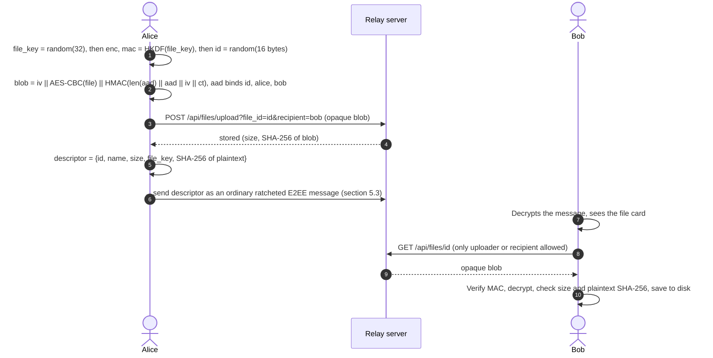
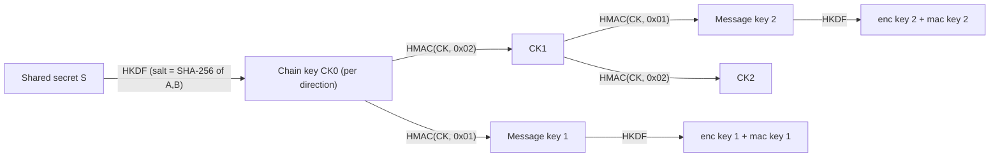

# SecureMsg: End-to-End Encrypted Messaging with Hybrid Cryptography

[](https://vinay3579-code.github.io/Secure-Messaging-Application/)
[](#13-testing)
[](#2-quick-start)
[](#6-cryptographic-design)

An educational, fully working end-to-end encrypted (E2EE) messenger built for the **Cryptography and Network Security (CNS)** course. Two users establish a shared secret over an untrusted relay using **signed Diffie-Hellman**, then exchange messages and files protected by a **forward-secret key ratchet** and **AES-256-CBC + HMAC-SHA256 (Encrypt-then-MAC)**. A live **Crypto Inspector** shows the protocol working, and an **Attack Lab** demonstrates five real attacks and how each defense stops them.

> **Core principle:** all keys and all plaintext exist only in the users' browsers. The relay server stores public keys, signatures and ciphertext. It never sees a private key, a shared secret, a message key, a file name, or any plaintext.

**Interactive Project Portfolio & Live Browser Demo:** https://vinay3579-code.github.io/Secure-Messaging-Application/

---

## Table of contents
1. [Feature overview](#1-feature-overview)
2. [Quick start](#2-quick-start)
3. [How to use the app](#3-how-to-use-the-app)
4. [Architecture](#4-architecture)
5. [Workflows (step by step)](#5-workflows-step-by-step)
6. [Cryptographic design](#6-cryptographic-design)
7. [Wire formats](#7-wire-formats)
8. [Crypto Inspector](#8-crypto-inspector)
9. [Attack Lab](#9-attack-lab)
10. [API reference](#10-api-reference)
11. [Database schema](#11-database-schema)
12. [Project structure](#12-project-structure)
13. [Testing](#13-testing)
14. [Configuration](#14-configuration)
15. [Security model, limitations and known trade-offs](#15-security-model-limitations-and-known-trade-offs)
16. [Roadmap](#16-roadmap)
17. [Troubleshooting](#17-troubleshooting)
18. [Team](#18-team)

---

## 1. Feature overview

| Area | Feature |
| :--- | :--- |
| **Key exchange** | Diffie-Hellman over the RFC 3526 2048-bit group. Only that standard group is accepted; peer values get a range and subgroup check. |
| **Authentication (anti-MITM)** | Every DH public value is signed with the sender's **RSA-2048-PSS** identity key. The signature binds the value to its role (A or B), both identities and the direction. The server rejects unsigned or forged values, and each client verifies the peer's signature and aborts on a mismatch. |
| **Forward secrecy** | A **symmetric hash ratchet**: the DH secret seeds one HMAC chain per direction, and every message uses a fresh one-time key that is erased after use. Out-of-order delivery works, and forged packets cannot burn keys or desync the chain. |
| **Message cipher** | **AES-256-CBC + HMAC-SHA256**, Encrypt-then-MAC, with independent encryption and MAC keys. The MAC covers IV, ciphertext, timestamp, sequence number, session, sender, receiver and message id, and is checked in constant time before any decryption. |
| **Encrypted file sharing** | Attach or drag and drop files up to 10 MB. Files are encrypted in the browser with the same cipher suite and a fresh per-file key. The relay stores an opaque blob; the key travels only inside an E2EE chat message. |
| **Browser-only keys** | Identity keys, DH secrets, ratchet chains and message keys are generated and used in the browser (WebCrypto). The server only holds public keys. |
| **Password security** | PBKDF2-HMAC-SHA256, 100,000 iterations, unique 16-byte salt, constant-time verification. |
| **Replay protection** | The relay rejects a reused message id (HTTP 409), and each client rejects a message whose one-time key was already consumed. |
| **Transport security** | Optional HTTPS with a generated self-signed certificate (`--https`). Message security does not depend on it. |
| **Messenger UI** | Three-pane layout: profile list with search, conversation, and a profile and actions panel (peer identity fingerprint, handshake, reset, tamper toggle). Drag and drop files, file cards, tamper and replay alerts. |
| **Crypto Inspector** | A live, tabbed, read-only view: handshake checklist, key exchange, ratchet timeline, every packet on the wire, and exactly what the relay database stores (including stored files). |
| **Attack Lab** | Five live scenarios: eavesdropping, tampering, replay, man-in-the-middle on DH, and a real CBC padding-oracle attack. Also runnable from the terminal. |
| **Tests** | 47 automated tests, including a Python to browser-JavaScript interoperability suite. |

---

## 2. Quick start

### Prerequisites
- Python 3.10 or newer
- `pip install -r requirements.txt` (Flask, cryptography)
- A modern browser (Chrome, Edge, Firefox). The app must be opened at `http://localhost`, `http://127.0.0.1` or over HTTPS, because WebCrypto requires a secure context.
- Optional: Node.js 18 or newer, only to run the Python to JavaScript interoperability tests.

### Run
```bash
pip install -r requirements.txt
python app.py                 # HTTP on http://127.0.0.1:5000
python app.py --https         # HTTPS on https://127.0.0.1:5443 (self-signed certificate is generated on first run)
python app.py --port 8080     # custom port
```
Open `http://127.0.0.1:5000`. The home page redirects to **Live chat**.

### Two-user demo (fastest path)
1. Open `http://127.0.0.1:5000/chat`. Use the **Demo users** links in the top bar to open **Alice** and **Bob** in two separate tabs. Each tab auto-registers the demo account (password `password123`) and generates its RSA identity key in that browser.
2. In Alice's tab, click the **bob** profile, then **Secure it now** (or **Start secure handshake**).
3. Watch the handshake complete in both tabs, then send messages and files in either direction.
4. Open the **Crypto Inspector** tabs under the chat to see the protocol state. Try the **Tamper** toggle.

### Run the tests and the terminal attack demo
```bash
python -m unittest discover -s tests      # 47 tests
python attacks/attack_simulator.py         # all five attacks in the terminal
```

---

## 3. How to use the app

### Pages
| Page | URL | Purpose |
| :--- | :--- | :--- |
| Live chat | `/chat` (also `/`) | Messenger plus the Crypto Inspector. |
| Attack lab | `/attacks` | Run the five attack and defense scenarios. |
| Account | `/login` | Sign in, register, or use the one-click demo accounts. |

### The chat screen
- **Left, Profiles:** every other registered user, with a search box. Click a profile to select that peer. The state under each name shows *Secure session*, *Not secured* or *Not connected*.
- **Centre, Conversation:** the peer's header and session badge, a banner with **Secure it now** when the chat is not yet secured, the messages, a handshake log strip, and the composer (paperclip to attach a file, text box, send).
- **Right, Profile and actions:**
  - the peer's avatar, member-since date and **identity key fingerprint** (compare it with them out of band),
  - the fixed cipher (CBC + HMAC-SHA256),
  - **Start secure handshake** and **Reset conversation**,
  - the **Tamper** switch (see below).

### Sending files
Click the paperclip or drag files onto the conversation (up to 10 MB each, several at once). The file is encrypted in your browser and uploaded as an opaque blob, then a file card appears in the chat. Either party can press **Download**, which fetches the blob, decrypts and verifies it in the browser, and saves it.

### Attack simulation toggle
With **Tamper** on, a text message is modified after encryption so the receiver's integrity check rejects it. For files, the uploaded blob is corrupted instead, so the file card still appears but the download fails with *Integrity check failed* and nothing is saved.

### Reset
**Reset conversation** deletes the stored messages, DH sessions and uploaded files between you and the selected peer, and clears the local session. Start a new handshake afterwards.

### Good to know
- **History and forward secrecy:** each message key is erased after use, so a message can only be displayed in the page session that sent or decrypted it. After a reload, earlier messages are not re-displayed (they cannot be decrypted any more, by design).
- **Session keys are memory-only:** reloading the page or starting a new handshake creates a fresh session.

---

## 4. Architecture



**Who sees what**

| Data | Alice's browser | Relay server | Bob's browser |
| :--- | :---: | :---: | :---: |
| RSA private identity key | yes | never | no |
| RSA public identity key | yes | yes | yes |
| DH private exponents | yes (own) | never | yes (own) |
| DH public values and signatures | yes | yes | yes |
| Shared secret, chain keys, message keys, file keys | yes | never | yes |
| Plaintext messages, file names and contents | yes | never | yes |
| Ciphertext, IV, MAC tag, timestamp, sequence number | yes | yes | yes |
| Who talks to whom, when, sizes | yes | yes | yes |

**Components**
- **Browser** (`static/js/crypto_client.js`, `chat.js`, `inspector.js`): all cryptography, the ratchet, the UI.
- **Relay** (`app.py`, `routes/`, `database.py`): accounts, public-key directory, DH session coordination with signature enforcement, message queue, file blob store, replay filter.
- **Python `crypto/` package:** reference implementations of every primitive. They serve the Attack Lab, the tests, and as the byte-compatible specification the browser is tested against.

---

## 5. Workflows (step by step)

### 5.1 Registration, login and identity key



### 5.2 Signed Diffie-Hellman handshake



What protects the handshake:
- The server **rejects** unsigned, forged, relabelled (different role or peer pair) or out-of-group values.
- Each **client verifies independently** with the peer's public key fetched from the directory, so a server that merely relays cannot mount an undetected MITM without also swapping the peer's identity key (see [limitations](#15-security-model-limitations-and-known-trade-offs)).
- After the handshake, the DH private exponent is erased.

### 5.3 Sending and receiving a message



### 5.4 Sending and downloading an encrypted file



The file key is protected by the same forward-secret ratchet as any message. The relay never sees the file name, type, contents or key.

### 5.5 Ratchet in one picture


Each arrow is one-way. Once `CK0` is overwritten, nobody, including the device owner, can recompute `MK1`, which is why earlier messages stay safe if the device is later compromised.

### 5.6 Attack Lab run
Open `/attacks`, pick a scenario, press **Run simulation**. The server runs real cryptography and returns telemetry, which the page prints (see [section 9](#9-attack-lab)).

---

## 6. Cryptographic design

| Goal | Primitive | Parameters | Notes |
| :--- | :--- | :--- | :--- |
| Key agreement | Diffie-Hellman | RFC 3526 MODP-2048, g = 2, 256-bit private exponent | Only this group is accepted. Peer values: `1 < y < p-1` and `y^q = 1 mod p` (prime-order subgroup). |
| Identity and MITM defense | RSA-PSS | RSA-2048, SHA-256, maximum salt (222 bytes) | Signed text: `cns-dh-v2|role|initiator|responder|public value`. |
| Key derivation | HKDF-SHA256 | transcript salt = SHA-256("A:B") | Separate labels for each direction, for the encryption key and the MAC key. |
| Forward secrecy | HMAC-SHA256 hash ratchet | `MK = HMAC(CK,0x01)`, `CK' = HMAC(CK,0x02)` | Per-direction chains. Up to 100 skipped keys are kept for out-of-order delivery. Symmetric ratchet only (no post-compromise security). |
| Confidentiality | AES-256-CBC | PKCS#7 padding, fresh 16-byte IV per message | One-time key from the ratchet. |
| Integrity and authenticity | HMAC-SHA256, Encrypt-then-MAC | independent MAC key | Verified in constant time before decryption. Also defeats padding-oracle attacks. |
| File encryption | same suite | fresh 256-bit file key, HKDF to enc and mac keys | The MAC is over a length-prefixed AAD, IV and ciphertext. |
| Password storage | PBKDF2-HMAC-SHA256 | 100,000 iterations, 16-byte random salt | Constant-time comparison. |
| Replay protection | message id plus ratchet | unique id per message | The relay rejects duplicates (409); the client rejects any consumed key. |
| Transport | TLS (optional) | self-signed certificate | Defense in depth; E2EE does not rely on it. |

**Ratchet safety properties**
- *Commit after authenticate:* the receive chain advances only if the packet authenticates, so a forged or tampered packet cannot burn keys or desynchronise the chat.
- *Out-of-order:* keys for skipped sequence numbers are derived and stored (deleted after use), so late messages still decrypt. Messages more than 100 ahead are refused.
- *Replay:* a sequence number at or below the chain position, with no stored key, is refused.

---

## 7. Wire formats

These are implemented identically in Python (`crypto/`) and JavaScript (`static/js/crypto_client.js`) and verified byte for byte by the interop tests.

**Signed DH payload**
```
cns-dh-v2|<A or B>|<initiator>|<responder>|<public value, lowercase hex, no leading zeros>
```

**Ratchet derivation**
```
salt            = SHA-256("<A hex>:<B hex>")
CK_init_to_resp = HKDF(S, salt, "cns-ratchet-v2 chain initiator->responder")
CK_resp_to_init = HKDF(S, salt, "cns-ratchet-v2 chain responder->initiator")
MK, CK'         = HMAC(CK, 0x01), HMAC(CK, 0x02)
enc_key         = HKDF(MK, "cns-ratchet-v2 message enc key")
mac_key         = HKDF(MK, "cns-ratchet-v2 message mac key")
```

**Message packet** (what the relay stores and forwards)
```json
{ "message_id": "msg-...", "receiver": "bob", "ciphertext": "<hex>", "iv": "<hex, 16 bytes>",
  "hmac_tag": "<hex, 32 bytes>", "timestamp": "<ISO 8601>", "seq_no": 3, "cipher_mode": "cbc-hmac" }
```
```
context = <session id>|<sender>|<receiver>|<message id>|cbc-hmac
tag     = HMAC-SHA256(mac_key, "<iv hex>:<ciphertext hex>:<timestamp>:<seq>:<context>")
```

**File blob** (stored on the relay)
```
blob = iv(16) || AES-256-CBC(PKCS#7) ciphertext || HMAC-SHA256 tag(32)
tag  = HMAC-SHA256(mac_key, len(aad) as 4 bytes big endian || aad || iv || ciphertext)
aad  = "cns-file-v1|<file id>|<sender>|<receiver>"
enc_key, mac_key = HKDF(file_key, "cns-file-v2 enc key" / "cns-file-v2 mac key")
```

**File descriptor** (sent as an ordinary encrypted chat message)
```json
{ "cns": "file", "v": 1, "id": "<32 hex>", "name": "report.pdf", "size": 123456,
  "key": "<64 hex file key>", "sha256": "<64 hex of the plaintext>" }
```

---

## 8. Crypto Inspector

A tabbed panel under the chat. It is read-only and refreshes every second. It shows fingerprints and public values only; private keys and message keys are never displayed or sent anywhere.

| Tab | What it shows |
| :--- | :--- |
| **Overview** | A verdict banner (for example *Secure channel established* with the shared-secret fingerprint) and a handshake checklist: identity key present, DH value signed and published, peer signature verified, shared secret derived, ratchet ready, sending cipher, message counts. |
| **Key exchange** | Peer, role (initiator or responder), session id, group parameters, your and the peer's public values, signature status, shared-secret fingerprint. |
| **Key ratchet** | Send and receive chain positions with chain-key fingerprints, stored skipped keys, and a timeline of every ratchet step showing the message key fingerprint struck through because it was erased. |
| **Packets** | Every packet sent or received: time, direction, sender to receiver, sequence number, cipher, IV, ciphertext, MAC tag and the result (*Verified*, *Integrity failed*, *Replay rejected*, *Sent (tampered)*). |
| **Relay database** | Exactly what the server stores: message rows and stored file blobs (size and hash only). No plaintext and no key material in any column. |

---

## 9. Attack Lab

Open `/attacks` (or run `python attacks/attack_simulator.py`). Each scenario executes real cryptography.

| # | Attack | What happens | Defense shown |
| :--- | :--- | :--- | :--- |
| 1 | **Eavesdropping** | A packet capture of plain HTTP shows the message; the capture of this system shows only ciphertext. | End-to-end encryption (plus optional TLS). |
| 2 | **Message tampering** | One byte of ciphertext is flipped in transit. | HMAC verification fails and the message is dropped before decryption. |
| 3 | **Replay** | A valid packet is re-sent. | The relay rejects the reused message id; clients reject a consumed one-time key. |
| 4 | **MITM on DH** | Eve substitutes both DH values. Unauthenticated DH is fully compromised; with RSA-signed values, Eve's substitution fails verification. | Signed DH values bound to identities. |
| 5 | **CBC padding oracle** | A real Vaudenay attack decrypts an unauthenticated CBC ciphertext **without the key** (thousands of oracle queries), then fails against Encrypt-then-MAC where every forged query gets the same answer. | MAC verified before padding is examined. The chat and file sharing use this design. |

---

## 10. API reference

All JSON unless noted. "Auth" means a session cookie or the `X-Sim-User` header (a demo convenience, see limitations).

### Pages
| Method | Path | Description |
| :--- | :--- | :--- |
| GET | `/` | Redirects to `/chat` |
| GET | `/chat`, `/login`, `/attacks` | HTML pages |

### Accounts
| Method | Path | Auth | Description |
| :--- | :--- | :---: | :--- |
| POST | `/api/auth/register` | no | Create an account (`username`, `password`, optional `public_identity_key`). Never returns a private key. |
| POST | `/api/auth/login` | no | Sign in; returns the stored public identity key. |
| POST | `/api/auth/identity` | password in body | Publish or rotate your RSA **public** key (re-authenticates with the password). |
| POST | `/api/auth/logout` | yes | End the session. |
| GET | `/api/auth/me` | yes | Current user and public key. |
| GET | `/api/auth/users` | yes | Other users with public keys and creation dates (feeds the profile list). |

### Key exchange (directory only)
| Method | Path | Description |
| :--- | :--- | :--- |
| POST | `/api/dh/initiate` | Publish A and its signature. The server enforces the group, subgroup and signature (400 otherwise). |
| POST | `/api/dh/respond` | Publish B and its signature (same enforcement). |
| GET | `/api/dh/pending` | The pending handshake addressed to you. |
| GET | `/api/dh/session/<id>` | Session record (public values and signatures). |
| GET | `/api/dh/active/<peer>` | The established session with a peer. |
| POST | `/api/dh/reset` | Delete messages, sessions and files between you and a peer. |

### Messages
| Method | Path | Description |
| :--- | :--- | :--- |
| POST | `/api/messages/send` | Relay an encrypted packet. `409 REPLAY_ATTACK_DETECTED` for a reused id; `400` unless `cipher_mode` is `cbc-hmac`. |
| GET | `/api/messages/receive/<peer>` | Fetch and mark-read unread packets from a peer. |
| GET | `/api/messages/history/<peer>` | Stored packets for the conversation (ciphertext only). |
| GET | `/api/server/relay-log` | Inspection endpoint: the last 50 stored packets and stored files. |

### Files
| Method | Path | Description |
| :--- | :--- | :--- |
| POST | `/api/files/upload?file_id=<32 hex>&recipient=<user>` | Raw `application/octet-stream` body (the encrypted blob). `400` bad id or blob, `404` unknown recipient, `409` id exists, `413` too large. |
| GET | `/api/files/<file_id>` | Download the blob. Only the uploader or recipient; everyone else gets `404`. Served as `no-store`, `nosniff`. |

### Attack Lab
`POST /api/attacks/eavesdrop`, `/tamper`, `/replay`, `/mitm`, `/padding-oracle`.

---

## 11. Database schema

SQLite file `messaging.db` (created automatically; older files are migrated on start).

| Table | Columns | Holds |
| :--- | :--- | :--- |
| `users` | id, username, password_hash, salt, public_identity_key, created_at | Accounts and **public** keys only. |
| `dh_sessions` | session_id, user1, user2, dh_p, dh_g, pub_a, pub_b, sig_a, sig_b, status, created_at | DH public values and signatures. New sessions supersede old ones. |
| `messages` | id, message_id, sender, receiver, ciphertext, iv, hmac_tag, timestamp, seq_no, is_read, cipher_mode, created_at | Ciphertext packets. |
| `processed_messages` | message_id, sender, receiver, seq_no, received_at | Replay filter. |
| `files` | file_id, uploader, recipient, size, sha256, created_at | File metadata. Blobs are stored in `uploads/<file_id>.bin`. |

---

## 12. Project structure

```text
Secure-Messaging-Application/
├── app.py                      # Flask entrypoint (HTTP and HTTPS), routes registration, 11 MB body limit
├── database.py                 # SQLite schema, migrations, helpers, file blob paths
├── generate_cert.py            # Self-signed TLS certificate generator
├── inspect_db.py               # Helper to inspect the database
├── requirements.txt            # Flask, cryptography
├── README.md
├── docs/                       # Static 9-tab GitHub Pages portfolio & live WebCrypto demo
├── uploads/                    # Encrypted file blobs (created at runtime, git-ignored)
│
├── crypto/                     # Python reference implementations
│   ├── auth.py                 # PBKDF2 password hashing
│   ├── dh.py                   # RFC 3526 DH, public-value validation (subgroup check)
│   ├── kdf.py                  # HKDF key derivation and fingerprints
│   ├── ratchet.py              # Symmetric hash ratchet (spec + tests)
│   ├── encryption.py           # AES-256-CBC (PKCS#7)
│   ├── integrity.py            # HMAC-SHA256 tags with context binding
│   ├── filecrypt.py            # Encrypted file blob format (CBC + HMAC)
│   ├── signatures.py           # RSA-PSS signing, signed-payload format
│   ├── aead.py                 # AES-256-GCM reference module (not used by the chat)
│   └── padding_oracle.py       # Vaudenay attack plus vulnerable and secure servers
│
├── routes/
│   ├── auth_routes.py          # register, login, identity, logout, me, users
│   ├── dh_routes.py            # signature-enforcing handshake directory
│   ├── message_routes.py       # send, receive, history, relay-log
│   ├── file_routes.py          # encrypted blob upload and download
│   └── attack_routes.py        # Attack Lab endpoints
│
├── attacks/attack_simulator.py # Terminal version of the five attacks
│
├── static/
│   ├── css/style.css           # Design system (light dashboard theme)
│   └── js/
│       ├── crypto_client.js    # Browser crypto: identity, signed DH, ratchet, CBC+HMAC, files
│       ├── chat.js             # Chat logic: polling, handshake, rendering, files, profiles
│       └── inspector.js        # Crypto Inspector (tabbed dashboard)
│
├── templates/
│   ├── _icons.html, _sidebar.html  # shared SVG sprite and navigation
│   ├── chat.html               # messenger and inspector
│   ├── attack_demo.html        # Attack Lab
│   └── login.html              # sign in / register
│
└── tests/
    ├── test_crypto.py          # primitives
    ├── test_attacks.py         # attack defenses, zero-plaintext storage
    ├── test_ratchet.py         # ratchet, GCM module, DH validation, padding oracle
    ├── test_e2e_flow.py        # Alice/Bob through the Flask API
    ├── test_files.py           # file format, relay rules, interop
    ├── test_js_interop.py      # Python <-> browser JavaScript
    └── js_interop_helper.js    # Node runner used by the interop tests
```

---

## 13. Testing

```bash
python -m unittest discover -s tests
```
47 tests, all passing:

- **Primitives:** PBKDF2, DH agreement and validation, HKDF separation, CBC + HMAC round trips, RSA-PSS signatures and forgery rejection.
- **Ratchet:** unique per-message keys, forward secrecy, replay rejection, out-of-order delivery, forged packets never desynchronise the chain, limits.
- **Handshake enforcement:** the server rejects unsigned, forged, relabelled, wrong-group and invalid-subgroup values; identity upload requires the password; removed server-side key endpoints return 404.
- **Full flow through the API:** Alice/Bob handshake, CBC + HMAC relay, tamper and replay rejection, and rejection of any other cipher mode.
- **File sharing:** format and layout, fresh key and IV per file, rejection of tampered ciphertext, IV, MAC, wrong key and wrong context; relay access rules (only uploader or recipient), validation and size limits, no overwrite, zero plaintext on disk, cleanup on reset, relay log exposes no names or keys.
- **Attacks:** the padding oracle decrypts plain CBC and fails against Encrypt-then-MAC.
- **Python to JavaScript interop** (needs Node.js 18 or newer, skipped otherwise): the real browser crypto code and the Python reference agree byte for byte on chain-key derivation, the ratchet, CBC + HMAC messages (including out-of-order, tampered and replayed delivery), file blobs in both directions, and RSA-PSS signatures.

The tests create throwaway `e2e_*` accounts and delete them afterwards.

### Measured cryptographic performance (Python reference)

| Operation | Measured latency | Notes |
| :--- | :---: | :--- |
| Ratcheted message round-trip (HMAC ratchet + AES-256-CBC + HMAC) | **0.13 ms** | Per message (encrypt, tag, verify, decrypt) |
| Signed MODP-2048 DH shared secret + subgroup check | **89.51 ms** | Once per session setup |
| RSA-2048-PSS sign / verify | **67.72 ms / 0.11 ms** | Handshake authentication |
| PBKDF2-HMAC-SHA256 (100,000 iterations) | **76.49 ms** | Registration / login |
| Encrypted file blob (10 MB, AES-CBC + HMAC + AAD) | **61.47 ms enc / 57.48 ms dec** | ~163 MB/s encrypt, ~174 MB/s decrypt |
| Vaudenay CBC padding oracle (2-block ciphertext) | **3,953 queries → decrypted** | **256 queries → 0 B leaked** on Encrypt-then-MAC |

---

## 14. Configuration

| Setting | How | Default |
| :--- | :--- | :--- |
| Port | `--port N` | 5000 (HTTP), 5443 (HTTPS) |
| Host | `--host H` | `127.0.0.1` |
| HTTPS | `--https` | off; generates `cert.pem` and `key.pem` if missing |
| Flask secret key | `FLASK_SECRET_KEY` environment variable | a hard-coded demo value (change for any real use) |
| File size limit | `MAX_FILE_BYTES` in `crypto/filecrypt.py` | 10 MB |
| Request body limit | `MAX_CONTENT_LENGTH` in `app.py` | 11 MB |
| Ratchet skip window | `MAX_SKIP` in `crypto/ratchet.py` and `crypto_client.js` | 100 |
| Polling interval | `startPolling()` in `chat.js` | 1 second |

---

## 15. Security model, limitations and known trade-offs

This is a teaching project, not a production messenger. Be aware of these honest limits:

- **Identity keys are trusted on first use.** Clients fetch the peer's public identity key from the server. A malicious server could substitute it. Compare the **identity key fingerprint** in the profile panel with your peer out of band. Safety-number and QR verification are planned.
- **`X-Sim-User` header.** To let two demo users share one browser, the API accepts an `X-Sim-User` header in place of a session. This allows impersonation and must be removed for any real deployment. It also means opening Alice and Bob in the same browser makes the sidebar name follow whichever logged in last.
- **Private identity key in `localStorage`.** Convenient for the demo, but readable by any script on the origin. A real client would use non-extractable keys or a password-protected keystore.
- **Hard-coded Flask secret and `debug=True`.** Demo defaults. Set `FLASK_SECRET_KEY` and disable debug for real use.
- **No post-compromise security.** The ratchet is symmetric: it gives forward secrecy but does not heal after a full state compromise (no DH ratchet).
- **Metadata is visible to the relay:** who talks to whom, when, message and file sizes.
- **Files stay on the relay until a reset.** Anyone holding a file key (which is inside that chat message) can decrypt the blob while it remains stored.
- **Whole-file encryption:** files are encrypted in one piece, so there is no upload progress and the size limit is 10 MB.
- **No rate limiting or account lockout**, and demo accounts use a known password.
- **Self-signed TLS certificate:** browsers show a warning; fine for a lab.
- **Single cipher by design.** Messages and files use CBC + HMAC only. The relay and the browser reject any other mode. A GCM reference module remains in the repository but is not used.

---

## 16. Roadmap

Planned next: safety numbers and QR fingerprint verification, self-destructing messages (TTL bound into the MAC), real-time delivery over WebSockets with delivery and read receipts, timestamp-freshness enforcement, login rate limiting and TOTP two-factor authentication, a tamper-evident hash-chained audit log, and a DH ratchet for post-compromise security.

---

## 17. Troubleshooting

| Symptom | Cause and fix |
| :--- | :--- |
| *WebCrypto is unavailable* | Open the app at `http://localhost:5000` or `http://127.0.0.1:5000`, or use `--https`. Plain HTTP on a LAN IP is not a secure context. |
| *This browser has no RSA identity key matching your account* | The account's public key on the server does not match this browser's stored key (for example after clearing site data). Sign out, then sign in on `/login` to generate and publish a new key. |
| *Handshake rejected* or *MITM alert* | A signature failed to verify: the peer's identity key changed, or a value was tampered with. Start a new handshake, and verify fingerprints. |
| Old messages show a red *Unsupported cipher mode* alert | They come from an earlier version that used a different cipher. Press **Reset conversation**. |
| Earlier messages are missing after a reload | Expected: message keys are erased after use (forward secrecy). |
| Download says *the encrypted file is no longer on the relay* | The conversation was reset, which deletes stored files. |
| Interop tests are skipped | Install Node.js 18 or newer. |
| Port already in use | Start with `--port 8080` (or another free port). |

---

## 18. Team

**Team 04** — 7th Semester B.E. Computer Science & Engineering, KLE Technological University, Hubballi.

| Member | Roll No | USN |
| :--- | :---: | :---: |
| Anusha Shigihalli | 402 | `01FE23BCS044` |
| Ananya Hiregoudar | 443 | `01FE23BCS104` |
| Amogh Talawar | 464 | `01FE24BCS414` |
| Vinay Madgi | 433 | `01FE23BCS306` |
